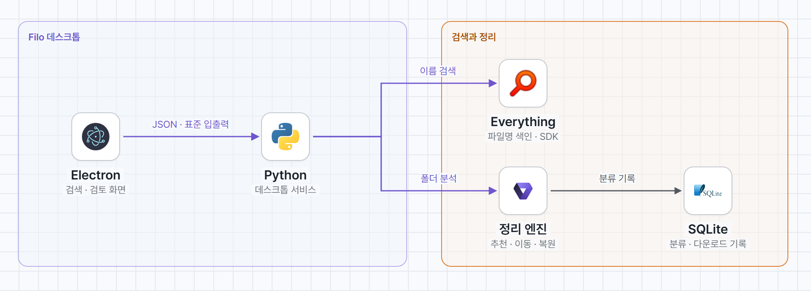

<p align="center">
  
</p>

<h1 align="center">Filo</h1>

<p align="center">PC에서 파일을 찾고, 같은 작업에 쓴 자료를 한 폴더에 모으세요.</p>

<p align="center">
  <a href="https://github.com/downloads-organizer-team/downloads-organizer/releases/download/v1.2.1/Filo-1.2.1-Setup-x64.exe"></a>
</p>
<p align="center">
  <a href="#빠른-시작">빠른 시작</a> ·
  <a href="docs/usage.md">사용 가이드</a> ·
  <a href="#앱-구조">앱 구조</a> ·
  <a href="https://github.com/downloads-organizer-team/downloads-organizer/issues">이슈</a>
</p>


## 빠른 시작

1. **찾기** 설치 후 시작 메뉴에서 **Filo**를 열고 이름 일부를 입력하세요. 결과 행을 한 번 누르면 수정한 날짜와 전체 경로가 보입니다. 이름을 두 번 누르면 파일이나 폴더가 열립니다.
2. **묶기** **파일 정리하기**에서 정리할 위치를 고르고 **분석 시작**을 누르세요. 기본 설정은 **관련 작업별 · 균형**입니다. 같은 형식의 파일을 모으고 싶으면 **확장자별**을 고르세요.
3. **옮기기** 추천 폴더를 펼쳐 파일을 확인하고 제외할 항목의 체크를 해제하세요. **이동 경로 미리보기**에서 목적지를 살핀 뒤 이동할 수 있습니다. 옮긴 파일은 **최근 정리**에서 복원할 수 있습니다.

설정에서 화면과 글자 크기(작게·보통·크게), 테마(시스템·라이트·다크)를 바꿀 수 있습니다.

## 어떤 파일을 함께 묶나요?

**다시 찾을 때 함께 필요한 파일을 묶습니다.** 예를 들어 1주차부터 9주차까지 매번 강의안과 실습 압축 파일을 함께 받았다면, 회차와 자료 구성이 반복된다는 단서를 이용해 한 강의 폴더를 추천합니다.

근거가 부족한 파일은 제자리에 둡니다. 내용이 같은 사본도 원래 위치에 남깁니다. 새 폴더를 만들려면 서로 다른 파일이 최소 세 개 필요하고, 기존 폴더에는 한 개도 추가할 수 있습니다. 실제로 옮길 파일은 사용자가 결정합니다. [예제 파일로 연습하기](demo.zip)

## 앱 구조

<picture>
  <source media="(prefers-color-scheme: dark)" srcset="docs/filo-stack-dark.png">
  
</picture>

검색과 정리는 Windows PC에서 실행됩니다. Everything은 파일명 색인을 조회하고, Python 정리 엔진은 선택한 위치의 파일을 비교합니다. 브라우저 다운로드 출처를 더하고 싶을 때는 Edge·Chrome 확장을 연결할 수 있습니다. [검색 설계](docs/search.md) · [정리 알고리즘](docs/analysis.md) · [구조도 제작 도구](https://github.com/caru-ini/stack-diagram)

## 소스에서 실행

Windows x64에서 Python 3.13, Node.js 22.12 이상과 npm을 준비하고 저장소 루트에서 실행하세요.

```powershell
npx.cmd --yes electron@45.3.3 ./desktop
```

전체 테스트는 `python -B -X utf8 -m unittest discover`로 실행합니다. [개발 및 설치 파일 빌드](CONTRIBUTING.md) · [사용 가이드](docs/usage.md)
