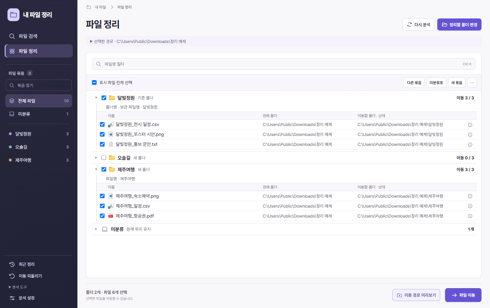

<p align="center">
  
</p>

<h1 align="center">다운로드 파일 정리</h1>

<p align="center">
  일상, 업무, 개인 프로젝트의 파일을 관련된 작업별로 모아 보세요.<br>
  앱을 열어 PC의 파일을 검색하고, 정리할 때만 폴더와 묶음 기준을 선택하세요.
</p>

<p align="center">
  <a href="https://github.com/downloads-organizer-team/downloads-organizer/releases/download/v1.2.0/Downloads-Organizer-1.2.0-Setup-x64.exe"></a>
</p>

<p align="center">
  <a href="#빠른-시작">빠른 시작</a> ·
  <a href="#소스에서-실행">소스에서 실행</a> ·
  <a href="CONTRIBUTING.md">기여 가이드</a> ·
  <a href="https://github.com/downloads-organizer-team/downloads-organizer/issues">이슈</a>
</p>



<p align="center"><sub>폴더별로 이동할 파일을 선택하고, 아래에서 선택한 개수와 이동 경로를 확인할 수 있습니다.</sub></p>

<details>
<summary><strong>목차</strong></summary>

- [빠른 시작](#빠른-시작)
- [추천 결과 검토하기](#추천-결과-검토하기)
- [다른 위치에서 파일 찾기](#다른-위치에서-파일-찾기)
- [브라우저에서 다운로드 출처 기록하기](#브라우저에서-다운로드-출처-기록하기)
- [소스에서 실행](#소스에서-실행)
- [저장소 둘러보기](#저장소-둘러보기)

</details>

## 빠른 시작

1. **설치와 검색** — Windows x64용 설치 파일을 실행하세요. 설치가 끝나면 시작 메뉴에서 **다운로드 정리**를 여세요. 첫 화면에 파일명 일부를 입력하면 일치하는 파일과 폴더가 표시됩니다.
2. **정리 시작** — **파일 정리하기**에서 폴더를 선택합니다. 기본 다운로드 폴더도 제외할 수 있습니다. 기본값인 **관련 작업별**은 파일명과 다운로드 단서를 비교합니다. **확장자별**을 선택하면 PDF, EXE처럼 마지막 확장자가 같은 파일을 모읍니다. 관련 작업별 최소 신뢰도는 0.0부터 1.0까지 0.1 단위로 조절합니다. 기본값은 0.7입니다.
3. **기존 폴더 활용 또는 새 폴더로만 정리** — 두 방식 모두 선택한 경로 바로 아래의 파일만 이동 후보로 삼습니다. 기존 폴더 활용은 폴더 이름과 바로 안의 파일명으로 목적지를 추천합니다. 새 폴더 이름이 이미 사용 중이면 번호를 붙입니다.
4. **검토하고 이동** — **분석 시작**을 누른 뒤 화면 상단에서 선택 경로를 확인하세요. 폴더 행을 펼치면 추천 근거와 파일별 원래 경로·예상 경로가 나타납니다. 여러 폴더를 동시에 펼칠 수 있습니다. 이동 가능한 추천 파일은 처음에 모두 선택됩니다. 폴더 체크를 해제하면 그 폴더를 한 번에 제외합니다. 하단에서 선택한 폴더 수와 파일 수를 확인하고 **파일 이동**을 누르세요. 경로를 먼저 보려면 **이동 경로 미리보기**를 누르세요. 새 묶음은 기본적으로 첫 선택 경로 아래에 생깁니다.

새 폴더에는 내용이 서로 다른 파일이 최소 3개 필요합니다. 크기가 같은 파일은 SHA-256으로 내용을 확인하며, 사본은 원래 위치에 둡니다. 체크를 해제하거나 파일명을 필터링하면 현재 보이는 파일을 기준으로 폴더별 이동 수와 보류 사유가 바뀝니다. 기존 폴더에는 한 파일만 추가할 수도 있습니다.

미분류 파일은 원래 위치에 두고, 목적지에 같은 이름의 파일이 있으면 건너뜁니다. **최근 정리 → 파일과 경로 보기**에서 예전 작업도 선택할 수 있습니다. **이 작업 복원 미리보기**에서 되돌아갈 경로를 확인하세요. 원래 경로가 사용 중이거나 이동한 파일이 바뀌면 사유를 표시합니다. 충돌을 해결하고 다시 복원하면 남은 파일만 처리합니다.

## 추천 결과 검토하기

파일 검색과 파일 정리에서 이름 글자를 한 번 클릭하면 항목을 선택합니다. 잠시 뒤 같은 이름을 다시 클릭하거나 F2를 누르면 이름을 편집합니다. Enter로 저장하고 Esc로 취소합니다. 기존 파일·폴더의 이름은 디스크에 바로 반영되며 **최근 정리**에서 되돌릴 수 있습니다. 제안된 새 폴더는 예상 이동 경로만 바뀝니다. [처리 순서와 사본 확인 도식](docs/file-organizing.html)

**관련 작업별**은 같은 작업에 쓰인 파일의 관계를 찾습니다. 예를 들어 `제주여행_항공권.pdf`, `제주여행_숙소예약.png`, `제주여행_일정.xlsx`는 서로 다른 형식이어도 같은 여행의 묶음으로 제안할 수 있습니다. 업무의 견적서·회의록·예산, 개인 프로젝트의 기획·디자인·결과물, 수업의 강의안·과제도 사용 예입니다.

파일명, 번호·버전 패턴, 실제 저장 위치, 생성·수정 시각, 남아 있는 다운로드 출처를 함께 비교합니다. 같은 날 받았거나 같은 사이트에서 왔다는 이유만으로 묶지 않습니다. 카카오톡이나 클라우드를 거치며 출처가 사라졌어도 나머지 단서를 사용합니다. `숙소예약.png`처럼 어느 여행인지 알 수 없는 파일은 억지로 연결하지 않고 미분류로 남길 수 있습니다.

**애매한 파일만 본문 분석**은 지원 문서의 일부를 읽어 추가 근거를 찾습니다. 예를 들어 `첨부.pdf`의 첫 페이지에 ‘Wireshark’가 있으면 네트워크 실습 자료와 연결할 수 있습니다. 모든 이미지·스캔 문서에 대한 OCR이나 내용 이해를 제공하는 것은 아닙니다. [강의 자료 예제 받기](demo.zip)

| 하고 싶은 일 | 앱에서 할 일 |
| --- | --- |
| 새 파일 분석 | **다시 분석**을 누릅니다. 선택한 각 폴더 바로 아래에서 총 3,000개까지 분석합니다. 다른 폴더를 정리하려면 **정리할 폴더 변경**에서 선택합니다. |
| 관련 파일 파악 | 파일 행 끝의 정보 버튼을 누르고 **관계 보기**를 선택합니다. 최대 5개 이웃과 연결 근거만 표시해 전체 파일이 얽힌 그래프를 피합니다. 연결된 이름을 누르면 해당 파일로 이동합니다. |
| 두 파일의 세부 점수 비교 | 왼쪽 **분석 도구 → 유사도 행렬**에서 셀을 누릅니다. 파일명·출처 등의 단서와 본문 분석 전후 점수를 볼 수 있습니다. |
| 파일 소속 수정 | 파일을 선택하고 목록 위 **다른 묶음·미분류로·새 묶음**을 누릅니다. 체크박스로 여러 파일을 함께 편집할 수 있습니다. **…**에는 병합·분리·개별 폴더 이동 등 추가 편집이 있습니다. |
| 폴더 이름 변경 | 트리에서 폴더 이름 글자를 클릭한 뒤 **F2**를 누릅니다. 새 이름을 입력하고 **Enter**로 저장합니다. |
| 목적지 변경 | **기존 폴더 활용**을 선택하면 묶음별로 맞는 기존 폴더를 찾습니다. 한 파일도 기존 폴더와 관련성이 높으면 추천할 수 있습니다. 직접 위치를 지정하려면 파일 선택 후 **… → 체크한 파일을 폴더로 이동**을 누르세요. |

## 다른 위치에서 파일 찾기

첫 화면의 **파일 검색**은 Everything 색인에서 파일과 폴더 이름을 찾습니다. 이름 글자를 빠르게 두 번 클릭하거나 Tab으로 이름에 초점을 맞춘 뒤 Enter를 누르면 폴더는 탐색기에서 열리고 파일은 Windows의 기본 연결 방식으로 열립니다. 오른쪽에는 전체 경로와 **경로 복사** 버튼이 있습니다.

- 앱에 **Everything 검색 엔진**이 들어 있습니다. 처음 열면 현재 계정이 읽을 수 있는 로컬 고정 드라이브의 파일과 폴더 이름을 색인합니다. 파일이 많으면 첫 검색까지 시간이 걸릴 수 있습니다.
- 색인을 준비하는 동안에도 검색어를 입력할 수 있습니다. 준비되면 마지막 검색어와 일치하는 경로를 최대 200개 표시합니다.
- 검색은 파일명 일부의 문자 그대로 일치입니다. 경로·와일드카드·Everything 검색 연산자는 입력하지 않습니다. 파일 묶음 추천의 정확도와 파일 검색 속도는 별도로 검증합니다.

SDK 연동 방식과 측정 방법은 [검색 연동 설계](docs/search.md)에 정리합니다.

### 브라우저에서 다운로드 출처 기록하기

**기본 분석·검색·정리는 확장 없이 동작합니다.** Windows의 `Zone.Identifier`에 다운로드 URL이 남아 있으면 설치 없이 활용합니다. 출처 기록이 없다는 이유로 확장 설치를 요구하지 않습니다.

페이지 제목·주소와 확인된 강좌명을 추가로 기록하고 싶을 때만 Edge 또는 Chrome 확장을 연결합니다. 확장으로 얻는 개선은 사이트와 파일에 따라 달라지며, 일괄적인 정확도 향상을 보장하지 않습니다. 웨일은 Chromium 확장 호환성만으로 Native Messaging 연동까지 보장할 수 없어 현재 검증된 지원 대상으로 안내하지 않습니다.

1. 앱의 **분석 설정 → 추가 분석 옵션 → 브라우저 출처 연결**을 눌러 확장 폴더 경로를 복사합니다.
2. 브라우저의 확장 관리 페이지에서 **개발자 모드 → 압축 풀린 파일 로드**를 선택하고 복사한 경로를 지정합니다.
3. 조선대학교 e-Class는 기본 연결됩니다. 다른 HTTPS 사이트에서는 확장 아이콘의 **이 사이트 연결**을 누르고 권한을 허용한 뒤 새로고침합니다.
4. 해당 페이지에서 Windows 다운로드 폴더로 파일을 받은 뒤 앱에서 **다시 분석**을 누르고 파일 행 끝의 정보 버튼을 엽니다.

## 소스에서 실행

Windows x64에서 Git, Python 3.13, Node.js 22.12 이상과 npm을 준비합니다. PowerShell에서 `python.exe --version`으로 Python 경로를 확인하세요. 처음 실행할 때 `npx`가 Electron을 내려받습니다.

```powershell
# 이 소스 폴더에서 실행합니다.
npx.cmd --yes electron@45.3.3 ./desktop
```

## 저장소 둘러보기

| 위치 | 역할 |
| --- | --- |
| [desktop/](desktop/) · [desktop_service.py](desktop_service.py) | Electron 화면과 Python 서비스 사이에서 파일 상세, 유사도 행렬, 이동 미리보기를 연결합니다. |
| [engine.py](engine.py) · [terms.json](terms.json) · [readers.py](readers.py) | 파일명과 한·영 용어를 비교하고 필요한 문서만 일부 읽어 그룹을 추천합니다. |
| [feedback.py](feedback.py) · [constraints.py](constraints.py) · [storage.py](storage.py) | 사용자가 정한 소속과 파일 관계를 저장하고 파일 이동과 복원을 처리합니다. |
| [browser_extension/](browser_extension/) · [capture_host.py](capture_host.py) | 선택적으로 Edge·Chrome에서 받은 파일과 다운로드 페이지를 연결합니다. |
| [file_search.py](file_search.py) · [vendor/](vendor/) | Everything SDK 연결과 실시간 파일명 검색을 담당합니다. |
| [test_pipeline.py](test_pipeline.py) · [test_desktop.py](test_desktop.py) | 예제 파일로 분류 결과, 그룹 편집, 파일 이동과 복원을 검증합니다. |

추천 점수의 기준과 지원 문서 형식은 [분석 설계](docs/analysis.md)에, 작업 브랜치·테스트 명령·PR 작성 예시는 [기여 가이드](CONTRIBUTING.md)에 있습니다.
