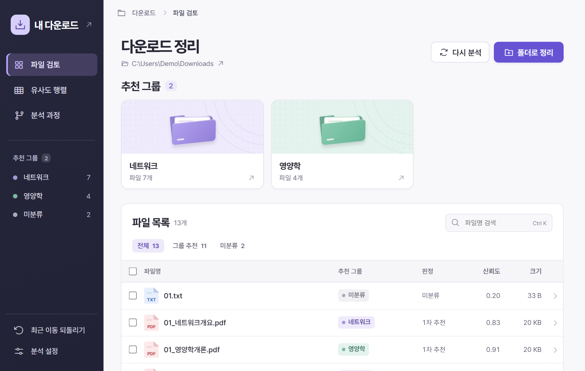

<p align="center">
  
</p>

<h1 align="center">다운로드 파일 정리</h1>

<p align="center">
  다운로드 폴더에 섞인 강의안과 과제를 수업별로 모아 보세요.<br>
  PDF 강의안, PPTX 실습 자료, ZIP 제출물도 같은 작업에 속하면 함께 추천합니다.
</p>

<p align="center">
  <a href="https://github.com/seungan123/downloads-organizer/releases/download/v1.0.0/downloads-organizer-windows-x64.zip"></a>
</p>

<p align="center">
  <a href="#빠른-시작">빠른 시작</a> ·
  <a href="#소스에서-실행">소스에서 실행</a> ·
  <a href="CONTRIBUTING.md">기여 가이드</a> ·
  <a href="https://github.com/seungan123/downloads-organizer/issues">이슈</a>
</p>



<p align="center"><sub>예제 파일 13개를 분석한 결과 · 네트워크 7개 · 영양학 4개 · 미분류 2개</sub></p>

<details>
<summary><strong>목차</strong></summary>

- [빠른 시작](#빠른-시작)
- [추천 결과 검토하기](#추천-결과-검토하기)
- [브라우저에서 다운로드 출처 기록하기](#브라우저에서-다운로드-출처-기록하기)
- [소스에서 실행](#소스에서-실행)
- [저장소 둘러보기](#저장소-둘러보기)

</details>

## 빠른 시작

1. **앱 열기** — [Windows 배포 페이지](https://github.com/seungan123/downloads-organizer/releases/tag/v1.0.0)의 **Assets**에서 `downloads-organizer-windows-x64.zip`을 받아 압축을 풀고 `start.cmd`를 두 번 클릭합니다. ZIP에 Electron과 Python이 들어 있습니다.
2. **추천 확인** — 앱이 내 다운로드 폴더를 분석하면 **파일 검토**에서 그룹을 고릅니다. 파일 이름을 누르면 추천 이유가 보입니다.
3. **폴더로 이동** — 전체 목록의 **폴더로 정리** 또는 선택한 그룹의 **이 그룹 정리**를 누릅니다. 미리보기에서 목적지를 확인하고 **○개 파일 이동**을 누르면 파일이 옮겨집니다.

미분류 파일은 원래 위치에 두고, 목적지에 같은 이름의 파일이 있으면 건너뜁니다. 방금 옮긴 파일은 왼쪽 아래 **최근 이동 되돌리기**에서 복원할 수 있습니다.

## 추천 결과 검토하기

예를 들어 `첨부.pdf`는 이름만 보면 어느 수업 자료인지 알기 어렵습니다. **애매한 파일만 본문 분석**을 켜면 첫 페이지에서 ‘Wireshark’를 찾아 `DNS_실습.pptx`, `wireshark_lab.zip`과 같은 네트워크 그룹으로 추천합니다. [예제 파일 받기](demo.zip)

| 하고 싶은 일 | 앱에서 할 일 |
| --- | --- |
| 새 파일이나 하위 폴더 분석 | 새로 받은 파일은 **다시 분석**을 누릅니다. 하위 폴더는 **분석 설정 → 하위 폴더 포함 → 적용하고 다시 분석**으로 포함합니다. 기본 범위는 다운로드 폴더 바로 아래이며 한도는 3,000개입니다. |
| 두 파일의 추천 근거 비교 | **유사도 행렬**에서 두 파일이 만나는 셀을 누릅니다. 파일명·출처 등의 단서와 본문 분석 전후 점수를 볼 수 있습니다. |
| 파일 소속 수정 | **선택 편집 → 다른 그룹으로 이동**에서 원하는 그룹이나 미분류를 고릅니다. 행렬에서는 두 파일을 **같은 그룹** 또는 **다른 그룹**으로 지정할 수 있습니다. |
| 그룹 이름이나 구성 변경 | **그룹 편집**에서 이름 변경·병합·분리를 선택합니다. **강의 표지로 과목명 찾기**를 켜면 강의소개 PDF나 PPTX의 표지도 이름 후보를 찾는 데 사용합니다. |

### 브라우저에서 다운로드 출처 기록하기

Edge나 Chrome을 연결하면 이후에 받는 파일의 상세 화면에서 웹페이지 제목과 주소, 확인된 강좌명을 볼 수 있습니다. 기본 분석은 확장 없이도 실행됩니다.

1. 앱의 **분석 설정 → 브라우저 출처 연결**을 눌러 확장 폴더 경로를 복사합니다.
2. 브라우저의 확장 관리 페이지에서 **개발자 모드 → 압축 풀린 파일 로드**를 선택하고 복사한 경로를 지정합니다.
3. 조선대학교 e-Class는 기본 연결됩니다. 다른 HTTPS 사이트에서는 확장 아이콘의 **이 사이트 연결**을 누르고 권한을 허용한 뒤 새로고침합니다.
4. 해당 페이지에서 Windows 다운로드 폴더로 파일을 받은 뒤 앱에서 **다시 분석**을 누르고 파일 행을 엽니다.

## 소스에서 실행

Windows x64에서 Git, Python 3.13, Node.js 22.12 이상과 npm을 준비합니다. PowerShell에서 `python.exe --version`으로 Python 경로를 확인하세요. 처음 실행할 때 `npx`가 Electron을 내려받습니다.

```powershell
git clone https://github.com/seungan123/downloads-organizer.git
cd downloads-organizer
npx.cmd --yes electron@45.3.3 ./desktop
```

## 저장소 둘러보기

| 위치 | 역할 |
| --- | --- |
| [desktop/](desktop/) · [desktop_service.py](desktop_service.py) | Electron 화면과 Python 서비스 사이에서 파일 상세, 유사도 행렬, 이동 미리보기를 연결합니다. |
| [engine.py](engine.py) · [terms.json](terms.json) · [readers.py](readers.py) | 파일명과 한·영 용어를 비교하고 필요한 문서만 일부 읽어 그룹을 추천합니다. |
| [feedback.py](feedback.py) · [constraints.py](constraints.py) · [storage.py](storage.py) | 사용자가 정한 소속과 파일 관계를 저장하고 파일 이동과 복원을 처리합니다. |
| [browser_extension/](browser_extension/) · [capture_host.py](capture_host.py) | Edge·Chrome에서 받은 파일과 다운로드 페이지를 연결합니다. |
| [test_pipeline.py](test_pipeline.py) · [test_desktop.py](test_desktop.py) | 예제 파일로 분류 결과, 그룹 편집, 파일 이동과 복원을 검증합니다. |

추천 점수의 기준과 지원 문서 형식은 [분석 설계](docs/analysis.md)에, 작업 브랜치·테스트 명령·PR 작성 예시는 [기여 가이드](CONTRIBUTING.md)에 있습니다.
